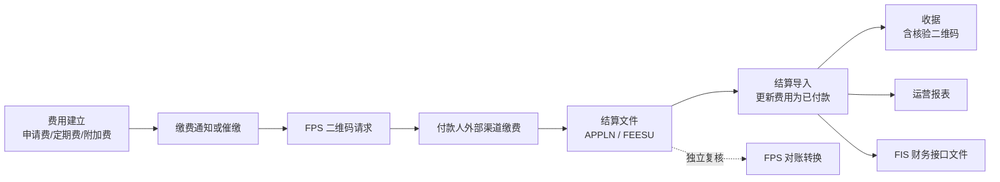

# OMSWeb 支付与费用管理 · 面试项目介绍

> **用途**：面试自我介绍、项目深挖、现场演示、简历撰写。
> **项目性质**：基于业务文档完成的遗留系统现代化复刻 / 本地可运行演示系统，不是生产系统。
> **技术栈**：Java 25 · Spring Boot 4.1 · PostgreSQL 18 · React 19 · TypeScript · Vite · JasperReports 7 · Apache POI · ZXing · Docker。
> **项目规模**：7 个业务页面、17 个 REST 接口、3 张业务表、3 套 PDF 模板、7 类运营报表 + FIS 导出、15 个后端测试，约 5,200 行源码（含前端样式与后端测试）。

---

## 1. 开场介绍

### 1.1 30 秒版本

> 我做过一个支付与费用管理系统的现代化项目。它把原来 JSF + Spring 的传统费用系统，重构成 React 19 + Spring Boot 4 + PostgreSQL 的运营平台，覆盖“费用建立 → 缴费通知/催缴 → FPS 二维码 → 外部付款 → 结算导入 → 收据 → 运营报表/FIS 导出”的完整闭环。
>
> 我重点解决了三件事：中文 PDF 与二维码的生成链路、Excel 结算文件的逐行校验与幂等更新、以及文档与 FPS 请求的生命周期管理。

### 1.2 2 分钟版本

> 这个项目的业务背景是：运营人员要维护申请费、定期费用和附加费，生成缴费通知或催缴提醒，付款人通过外部 FPS 渠道缴费，之后运营再导入银行/渠道的结算文件，系统更新费用状态并出具收据，财务使用报表和 FIS 接口文件做后续处理。
>
> 我把它拆成 7 个页面和 17 个接口：总览、费用台账、结算导入、FPS 对账、通知与收据、FPS 请求、运营报表。
>
> 技术上，前端是 React + TypeScript + Vite，后端是 Spring Boot 4 + Spring JDBC，数据库用 PostgreSQL 18，Flyway 管理迁移，Quartz 跑定期计费。Excel 用 POI，PDF 用 JasperReports，二维码用 ZXing，文档可以存本地或 S3 兼容存储，整套应用用 Docker 多阶段构建。
>
> 比较有代表性的难点是 PDF 链路：JasperReports 7 改了模板格式，中文字体需要 Identity-H 嵌入；而在 Spring Boot 可执行 JAR 里，报表表达式编译器看不到嵌套依赖。我的做法是构建期把 JRXML 预编译成 `.jasper`，运行时直接加载，并把 Noto Sans SC 作为字体扩展打进应用。最后在 macOS 和 Linux 容器里都验证了中文 PDF，并在本机把生成的 PDF 重新扫描，确认二维码内容。
>
> 另外，通知/催缴 PDF 会复用或自动创建 FPS 请求，把二维码嵌入 PDF；收据则附核验二维码。结算导入按行反馈成功或失败，不会因为一行错误回滚整批。

---

## 2. 项目背景与目标

### 2.1 原系统的问题

- JSF / ICEfaces 页面交互重，前后端耦合。
- 费用、通知、二维码、结算、收据、报表分散在多个入口。
- 报表和文件生成依赖服务端组件，调试和部署成本高。
- 结算文件来自外部，格式与行错误多，若缺少逐行反馈，运营排查成本高。
- 单据编号、收据唯一性、二维码有效期等规则缺少现成接口说明，迁移时需要在数据层重新表达。

### 2.2 现代化目标

- 浏览器端统一运营工作台，REST/JSON 交互。
- 费用域建模清晰：申请费、定期费用、附加费及其结算字段。
- 把通知、收据、FPS 二维码、结算导入、对账、报表串成闭环。
- 用数据库约束和事务保证关键不变量。
- 一套 OCI 镜像交付，支持本地一键启动。

### 2.3 明确的演示边界

- 不调用真实 FPS、银行、邮件、FIS 接口。
- 二维码内容是演示 URL；FPS 响应是模拟数据。
- 投递状态固定为“未投递”。
- 没有登录、权限、审计、多租户。
- 单实例部署，Quartz 使用内存 JobStore。

> 面试时主动讲边界，比被追问后再解释更加分。

---

## 3. 业务全景

### 3.1 主流程



### 3.2 三类角色

| 角色 | 关注点 |
| --- | --- |
| 运营人员 | 应收费用、逾期跟进、通知/催缴、二维码、结算导入、收据 |
| 付款人 | 收到通知，通过 FPS/银行转账完成付款 |
| 财务人员 | 月度收入、非付款结算、TIP、FIS 接口文件 |

### 3.3 必须讲清楚的业务规则

- **费用类型**：申请费（需申请编号）、定期费用、附加费（必须关联原费用，演示规则只允许逾期未缴的定期费用，且一笔原费用只能有一笔附加费）。
- **结算导入**：APPLN 按申请编号匹配，FEESU 按费用 ID 匹配；只更新未结算费用；逐行返回结果。
- **FPS 对账 ≠ 结算**：对账页只做转换和异常复核，不直接更新费用；费用更新必须走结算导入。
- **通知/催缴**：未结算可生成通知；催缴只针对已逾期；可重复生成。
- **收据**：只对已结算费用生成；一笔费用只能有一张收据。
- **二维码**：未结算费用才能生成 FPS 请求；默认 30 天到期；通知/催缴会复用有效请求，没有才创建。
- **报表**：FEE004R01–R07，分别对应费用资料、到期定期费用、未结清附加费、月末未结清、非付款结算、月度收入、TIP。
- **FIS**：交易参考编号、金额、借贷标识、收入代码、到期日、计划/收入账户标识。

---

## 4. 技术架构

### 4.1 分层结构

```text
浏览器
  │  React 19 + TypeScript + Vite（同一站点，静态资源由 Spring Boot 提供）
  │  REST/JSON + multipart 上传 + PDF/CSV 下载
  ▼
Spring Boot 4 / Spring MVC
  │  Controller → Service → Spring JDBC（JdbcClient）
  ├─ Quartz：定期计费
  ├─ Apache POI：APPLN / FEESU 工作簿
  ├─ JasperReports：通知 / 催缴 / 收据 PDF
  ├─ ZXing：FPS 二维码 PNG
  └─ DocumentStorage：本地目录 / S3 兼容对象存储
  ▼
PostgreSQL 18（Flyway 管理表结构）
```

### 4.2 技术选型

| 层 | 技术 | 作用 |
| --- | --- | --- |
| 前端 | React 19、TypeScript、Vite | 运营工作台、报表页、上传与下载交互 |
| 后端 | Java 25、Spring Boot 4.1 | REST、校验、事务、静态资源托管 |
| 数据访问 | Spring JDBC `JdbcClient` | 手写 SQL、结果集映射、批量/序列操作 |
| 数据库 | PostgreSQL 18、Flyway | 事务、JSONB、部分唯一索引、迁移版本化 |
| 调度 | Quartz | 月度定期计费演示任务 |
| Excel | Apache POI 5.5 | `.xls` / `.xlsx` 解析与模板生成 |
| PDF | JasperReports 7.0 + Noto Sans SC | 中文通知、催缴、收据 PDF |
| 二维码 | ZXing 3.5 | FPS 二维码 PNG |
| 存储 | 本地文件 / AWS SDK S3 | 生成文档持久化 |
| 交付 | Docker 多阶段构建、Docker Compose | 前端构建 + 后端 Jar + PostgreSQL |
| 测试 | JUnit 5、Mockito、AssertJ | 报表、导入、文档规则、二维码编解码 |

### 4.3 跟着一个请求走：`POST /api/documents`

以“生成缴费通知”为例：

1. Controller 校验 `feeId`、`kind`。
2. `DocumentService` 查询费用，校验状态（通知/催缴必须未结算，收据必须已结算且未出过收据）。
3. 从数据库序列取文档流水号，生成 `NOT-年份-序号`。
4. 调用 `FpsService.activeOrCreate(feeId)`：
   - 有未过期的 `DEMO` 请求 → 复用；
   - 没有 → 创建新的 FPS 请求（编号、到期日、请求/响应 JSONB）。
5. ZXing 把二维码内容渲染成 PNG。
6. JasperReports 填充预编译模板，生成 PDF。
7. 文档写入本地目录或 S3，返回存储 key。
8. `fee_documents` 插入记录（编号、生成时间、投递状态、金额、存储 key）。
9. 返回 JSON，前端刷新列表，用户可下载 PDF。

文档与 FPS 请求记录在同一个数据库事务里；PDF 先写入存储再插入记录，渲染或数据库写入失败会回滚业务记录，生产环境还需要孤儿文件清理任务。

### 4.4 代码地图

| 关注点 | 主要文件 |
| --- | --- |
| 费用与计费 | `backend/src/main/java/com/omsweb/fees/FeeService.java` |
| 通知/收据/二维码嵌入 | `backend/src/main/java/com/omsweb/fees/operations/DocumentService.java` |
| FPS 请求与二维码 | `FpsService.java`、`QrCodeRenderer.java`、`FpsController.java` |
| 结算导入 | `SettlementImportService.java` |
| FPS 对账 | `ReconciliationService.java` |
| 报表与 FIS | `ReportService.java` |
| PDF 模板 | `backend/src/main/resources/reports/*.jrxml` |
| 中文字体扩展 | `backend/src/main/resources/fonts/` |
| 前端外壳与路由 | `frontend/src/App.tsx` |
| 运营报表页 | `frontend/src/Reports.tsx` |

---

## 5. 功能地图

| 页面 | 用户价值 | 技术要点 |
| --- | --- | --- |
| 总览 | 应收、已结算、待结算、逾期 KPI；趋势与状态图；逾期跟进 | 前端聚合、conic-gradient 圆环、响应式图表 |
| 费用台账 | 新建/编辑费用、附加费关联、运行定期计费 | 类型校验、`source_fee_id` 唯一、`periodic_key` 幂等 |
| 结算导入 | 上传 APPLN/FEESU，逐行反馈，更新结算字段 | POI、表头/工作表校验、日期解析、逐行事务、匹配规则 |
| FPS 对账 | 转换对账 CSV，查看成功/异常记录 | Commons CSV、金额校验、只读复核 |
| 通知与收据 | 生成/下载通知、催缴、收据；按日期/入账日筛选 | JasperReports、编号序列、收据唯一索引、PDF 内嵌二维码 |
| FPS 请求 | 生成演示请求，预览/下载二维码 | 到期计算、请求复用、ZXing、请求/响应 JSONB |
| 运营报表 | 7 类报表查询与 CSV 导出；FIS 文件下载 | 口径实现、日期范围、UTF-8 BOM、FIS 无 BOM |

---

## 6. 我做了什么（可直接用于面试表述）

- **需求与领域建模**：把费用、附加费、结算、文档、FPS 请求、报表拆成独立聚合，明确状态机和唯一约束。
- **后端实现**：17 个 REST 接口、3 张业务表、Flyway 迁移、Quartz 任务、统一异常处理与校验。
- **文件链路**：POI 模板与导入、JasperReports 中文 PDF、ZXing 二维码、PDF 内嵌二维码、CSV 导出。
- **前端实现**：应用外壳、Hash 路由、7 个页面、筛选/表单/上传/下载、移动端适配。
- **交付与质量**：Docker 多阶段镜像、`start.sh` 一键启动、15 个单元测试、Playwright 桌面/移动端验证。
- **验证意识**：不仅“能生成 PDF”，还从渲染后的 PDF 中重新扫描二维码，确认内容与请求编号一致。

### 可量化结果

- 7 个业务页面、17 个 REST 接口。
- 3 张业务表、2 个 Flyway 迁移、3 套 PDF 模板。
- 7 类运营报表 + 1 个 FIS 导出。
- 15 个后端测试全部通过。
- Docker 镜像构建成功，Linux 容器内中文 PDF 验证通过；二维码从生成到扫描在本机完成验收。
- 桌面与移动端浏览器验证无控制台错误、无页面横向溢出。

---

## 7. 五个技术亮点（STAR）

### 7.1 中文 PDF + 二维码：从模板到可扫描

- **S**：JasperReports 7 使用新的 XML 模板格式；中文需要 Identity-H 字体嵌入；Spring Boot 可执行 JAR 中，报表表达式编译器无法读取嵌套依赖。
- **T**：稳定生成中文通知、催缴、收据 PDF，并在 PDF 中嵌入可扫描的 FPS 二维码。
- **A**：
  - 用 JasperReports 7 兼容格式生成/维护模板；
  - 内置 Noto Sans SC，TTC/TTF 静态实例 + 字体扩展；
  - 构建期用 `ReportTemplateCompiler` 预编译 `.jasper`，运行时直接加载；
  - ZXing 生成 360×360 PNG，作为 `InputStream` 参数传给 JasperReports；
  - 从渲染后的 PDF 中反向扫描二维码做验收。
- **R**：3 套模板、A4 单页 PDF，中文与二维码正常；中文渲染在 macOS 与 Linux 容器验证，二维码在生成的 PDF 上扫描验证。

### 7.2 通知/收据与 FPS 请求的生命周期

- **S**：通知需要付款二维码，但 FPS 请求原本是独立功能；重复生成通知不应产生重复二维码。
- **T**：让文档和 FPS 请求形成闭环，同时避免重复和过期请求。
- **A**：
  - `activeOrCreate`：优先复用 `status=DEMO` 且未过期的请求，否则创建；
  - 文档与 FPS 请求记录放在同一事务，PDF 先写入存储；
  - 收据使用独立的核验二维码，不误导付款；
  - 二维码请求编号和有效期写入 PDF。
- **R**：重复生成通知保持同一请求；FPS 页面记录一致；二维码扫描结果与请求编号匹配。

### 7.3 Excel 结算导入：逐行可定位、可重试

- **S**：结算工作簿来自外部，格式/日期/匹配错误多；整批失败会让运营无法定位。
- **T**：逐行校验、逐行反馈、只更新合法记录。
- **A**：
  - 校验工作表名、表头、列数、公式、日期格式和文本长度；
  - APPLN 按申请编号唯一匹配，匹配不到或多笔则报错；
  - FEESU 按费用 ID 匹配；
  - 结算 SQL 带 `WHERE status = 'UNPAID' RETURNING`，防止重复结算；
  - 每行独立事务，返回行号、参考号、成功/失败与原因。
- **R**：运营可只修正失败行后重传；重复上传不会重复结算；4 个单元测试覆盖成功、未匹配、缺工作表、表头错误。

### 7.4 报表与财务接口：让口径可解释

- **S**：报表口径多，金额、日期、状态和导出编码容易出错。
- **T**：实现 7 类运营报表和 FIS 文件，保证可复核。
- **A**：
  - 每个报表对应明确的筛选条件（到期日、结算日、银行入账日、月末截止日）；
  - 金额统一 `BigDecimal` / `NUMERIC(14,2)`；
  - 报表 CSV 加 UTF-8 BOM 便于 Excel；FIS 文件保持无 BOM，便于财务接口；
  - 用单元测试固定收入分组、月末口径、CSV 转义和 FIS 字段。
- **R**：5 个报表测试覆盖分组、截止日、字段与编码；财务可按银行入账日导出。

### 7.5 工程化交付与可验证性

- **S**：本地依赖多（Java、Node、PostgreSQL、字体），容易出现“我这能跑”。
- **T**：一条命令启动，镜像可复现。
- **A**：
  - Docker 多阶段构建（Node 构建前端 → Maven 构建后端 → JRE 运行）；
  - Docker Compose 管理 PostgreSQL；
  - `start.sh` 串起数据库、前端构建、后端打包和启动；
  - Flyway 保证新环境自动建表；
  - 本地/S3 存储抽象，便于切换。
- **R**：`./start.sh` 全流程通过；Docker 镜像构建成功；容器内生成并下载 PDF 验证通过。

---

## 8. 关键设计取舍

| 决策 | 选择 | 理由 | 代价 / 改进 |
| --- | --- | --- | --- |
| 数据访问 | Spring JDBC `JdbcClient` | 报表和批量 SQL 多，SQL 可控，映射直观 | 手写映射；复杂域可引入 JPA/MyBatis |
| 结算事务 | 每行独立事务 | 允许部分成功，运营可修正失败行 | 需要批次日志与重试机制 |
| 文档生成 | 同步生成 | 演示简单、用户即时下载 | 生产应改异步队列 + 生成状态 |
| 编号 | 数据库序列 | 并发安全，规则简单 | 回滚会产生编号空洞 |
| 收据唯一 | 部分唯一索引 + 预检查 | 数据库兜底，避免并发重复 | 需要友好错误提示 |
| 二维码 | ZXing 本地生成 | 无外部依赖，便于演示 | 真实 FPS 应使用接口返回的二维码 |
| 对账 | 只转换不复核回写 | 职责分离，避免错账 | 需要人工确认后走结算导入 |
| 调度 | Quartz RAM JobStore | 单实例演示简单 | 生产应使用 JDBC JobStore + 集群 |
| 前端路由 | Hash 路由 | 零依赖、静态托管简单 | 生产可用 React Router + 服务端 fallback |
| 存储 | 本地目录 / S3 抽象 | 演示简单，接口可切换 | S3 路径未在真实桶验证 |

---

## 9. 演示脚本

### 9.1 演示前检查

```bash
cd "Payment and Fee Management Modern"
./start.sh
```

打开 http://localhost:8080，按 **⌘ + Shift + R** 强制刷新，避免旧前端缓存。

如需完全干净的演示数据：

```bash
docker compose down -v
rm -rf .local-data
./start.sh
```

> 会清空数据库和本地文档，重新生成 14 笔演示费用。

### 9.2 3 分钟版本（适合一面/电话面配截图）

1. **总览**：讲应收、已结算、待结算、逾期四个 KPI，以及趋势和状态图。
2. **费用台账**：筛选“未结算”，指出申请费/定期费/附加费的类型规则。
3. **通知与收据**：为一条逾期费用生成催缴提醒，下载 PDF，展示 PDF 中的 FPS 二维码。
4. **FPS 请求**：打开二维码预览，说明“请求编号、到期日、付款人扫码”。
5. **运营报表**：切到月度收入，说明按银行入账日汇总；下载 CSV。

**讲解重点**：业务闭环 + 一个技术亮点（PDF/二维码）。

### 9.3 8 分钟版本（现场演示）

1. **总览**：30 秒讲业务与数据。
2. **费用台账**：打开一条未结算费用，说明状态机和附加费规则。
3. **通知与收据**：生成缴费通知 → PDF 含二维码 → 下载。
4. **FPS 请求**：查看自动创建的请求，预览二维码，说明“复用/到期”逻辑。
5. **结算导入**：下载 APPLN 模板 → 上传 → 逐行成功/失败结果。
6. **通知与收据**：为刚结算的费用生成收据 → PDF 含核验二维码。
7. **运营报表**：查看月度收入变化，导出 FIS 文件。
8. **收尾**：打开 `README.md` 或代码，讲一个技术难点和生产化边界。

### 9.4 演示时的表达模板

- “这一页解决的是……问题。”
- “这里有一个业务约束：……”
- “技术上我用……，因为……；代价是……。”
- “如果是生产环境，我会把这里改成……。”

避免逐页念功能，重点讲 **为什么这样设计**。

---

## 10. 高频追问 Q&A

### 业务类

**Q1：FPS 二维码请求到底是什么？**
> 它不是收款本身，而是把一张未缴账单变成可扫码的 FPS 支付请求：我们向外部 FPS 接口提交金额、币种、账单号、到期日，拿到二维码；付款人扫码后由银行完成扣款。OMSWeb 只负责请求、保存和展示，结算仍要通过结算导入登记。

**Q2：为什么 FPS 对账不直接更新费用？**
> 原系统职责分离：对账页负责转换和异常复核，结算导入负责正式入账。这样可以避免对账文件解析错误直接影响应收，保留人工确认环节。

**Q3：APPLN 和 FEESU 有什么区别？**
> APPLN 按申请编号匹配申请费，适合申请费场景；FEESU 按费用 ID 匹配，适合定期费用和附加费。APPLN 同一申请编号对应多笔费用时会拒绝，要求改用费用 ID。

**Q4：收据为什么只能开一张？**
> 收据是结算凭证，一笔费用重复开票会造成财务重复记录。数据库用部分唯一索引兜底，服务层先检查并返回友好提示。

**Q5：非付款结算是什么？**
> 指减免、作废等不产生实收的结算方式。费用状态记为 `NON_PAYMENT`，报表 FEE004R05 单独列出，不计入月度收入。

### 技术类

**Q6：为什么用 Spring JDBC 而不是 JPA？**
> 这个系统以报表、批量更新和明确 SQL 为主，表结构不复杂。`JdbcClient` 让 SQL 和映射更可控，避免 ORM 的隐式查询和 N+1；代价是手写映射，复杂域模型可以再引入 JPA。

**Q7：事务边界在哪里？**
> 结算导入按行提交，允许部分成功；文档生成把 FPS 请求创建与文档记录插入放在同一事务，PDF 存储写入在提交前完成，失败时回滚业务记录（生产环境需清理孤儿文件）；费用更新用 `WHERE status='UNPAID' RETURNING` 防重复。

**Q8：金额怎么处理？**
> 数据库 `NUMERIC(14,2)`，Java 用 `BigDecimal`，格式化用 `DecimalFormat`；不使用 `double`，避免二进制浮点误差。

**Q9：中文 PDF 怎么解决？**
> Noto Sans SC 作为字体扩展嵌入，PDF 使用 Identity-H 编码；模板字体统一为 OMS Sans；中文 PDF 在 macOS 和 Linux 容器都验证过，二维码从 PDF 渲染结果中重新扫描验证。

**Q10：为什么构建期预编译 `.jasper`？**
> Spring Boot 可执行 JAR 的依赖在嵌套 JAR 里，JasperReports 的表达式编译器按 `java.class.path` 找不到 JasperReports 类。构建期用 `exec-maven-plugin` 调 `ReportTemplateCompiler` 预编译，运行时直接加载序列化报表，既绕过问题也加快启动。

**Q11：二维码重复/过期怎么处理？**
> `activeOrCreate` 先查该费用 `status='DEMO'` 且 `expires_on >= today` 的请求，复用；没有则新建。默认 30 天，可通过 `OMS_FPS_EXPIRY_DAYS` 配置。

**Q12：如何保证导入幂等？**
> 结算 SQL 只更新 `UNPAID` 记录并返回结果；重复行会得到“已结算”的冲突提示。文档编号用数据库序列；收据有唯一索引；定期计费用 `periodic_key` 唯一约束。

**Q13：报表口径怎么保证？**
> 每个报表有明确的日期字段和状态过滤，核心口径用单元测试固定；CSV 转义、BOM、FIS 字段都有测试或手工验证。

**Q14：如果数据量变大怎么办？**
> 先加索引和分页（费用、文档、FPS 查询）；文档生成改异步队列；报表可预计算或走只读库；Quartz 换 JDBC JobStore；对象存储替换本地目录。

### 生产化 / 反思类

**Q15：这个系统离生产还差什么？**
> 鉴权与角色、审计日志、真实 FPS/FIS/邮件适配、异步任务与重试、幂等键、限流、监控告警、多实例调度、数据权限、历史数据迁移和正式模板。当前是演示系统，不夸大。

**Q16：如果重做，你会怎么改？**
> 引入端口/适配器隔离外部接口（FPS、FIS、邮件）；文档生成异步化并记录状态；前端引入路由和组件库；补集成测试和契约测试；把报表查询拆成只读模型；加入可观测性。

**Q17：你最大的收获是什么？**
> 从“写功能”转向“对业务不变量负责”：编号、唯一性、事务、状态机、文件编码、PDF 字体这些细节，才是业务系统能否被运营和财务信任的关键。

**Q18：这是你独立完成的吗？/ 有没有用 AI？**
> 如实说明项目性质与开发方式。如果使用了 AI 辅助，可以这样表述：“这是基于业务文档完成的个人项目，需求和验收由我定义，AI 用于提升编码效率；每个关键设计（PDF 预编译、二维码复用、事务边界、导入校验）我都能解释并验证。”不要回避，也不要夸大。

---

## 11. 简历写法

### 11.1 项目条目（可直接改）

**OMSWeb 支付与费用管理现代化｜个人项目**
`React 19 · TypeScript · Vite · Java 25 · Spring Boot 4 · PostgreSQL 18 · Flyway · Quartz · JasperReports · Apache POI · ZXing · Docker`

- 基于遗留费用系统业务文档，完成 7 个运营页面、17 个 REST 接口的现代化实现，覆盖费用、通知/催缴、FPS 二维码、结算导入、收据、报表与 FIS 导出。
- 设计费用/文档/FPS 三表模型与 Flyway 迁移，使用数据库序列、部分唯一索引和条件更新保证编号、收据唯一与结算幂等。
- 解决 JasperReports 7 中文 PDF 与可执行 JAR 表达式编译问题：构建期预编译 `.jasper`、内嵌 Noto Sans SC、Identity-H 编码，中文 PDF 在 macOS 与 Linux 容器验证通过。
- 用 ZXing 实现 FPS 二维码生成、预览、下载，并打通“通知/催缴复用有效请求、收据附核验二维码”的文档生命周期。
- 编写 15 个后端测试（JUnit 5/Mockito/AssertJ），完成 Docker 多阶段构建、`start.sh` 一键启动与桌面/移动端交互验证。

### 11.2 技术关键词

Java 25、Spring Boot 4、Spring MVC、Spring JDBC、PostgreSQL、Flyway、Quartz、REST、React 19、TypeScript、Vite、Apache POI、JasperReports、ZXing、Docker、S3、JUnit 5、Mockito。

### 11.3 不建议写进简历的表述

- “支撑百万级用户/高并发”——没有数据支撑。
- “对接真实 FPS/FIS/银行接口”——目前是演示适配。
- “生产环境稳定运行”——项目是本地演示系统。
- “独立从 0 到 1 设计企业级架构”——过度包装，容易被追问。

---

## 12. 真实性边界（面试前务必看）

**项目性质**
- 基于公开业务文档的现代化复刻/个人项目，用于验证遗留系统迁移与费用域建模能力。
- 非生产系统，无真实客户、真实资金、真实接口。

**已经验证**
- 费用、通知/催缴/收据、FPS 请求、结算导入、对账、报表、FIS 的完整演示流程。
- 中文 PDF 在 macOS 与 Linux 容器中验证通过；PDF 内嵌二维码在本机生成后重新扫描验证。
- 15 个后端测试、Docker 构建、桌面与移动端页面检查。
- 重复生成通知复用同一 FPS 请求；重复结算会被拒绝。

**尚未验证 / 未实现**
- 真实 FPS、FIS、银行、邮件接口。
- 登录、权限、审计、多租户。
- 高并发、压力测试、生产监控、备份恢复。
- S3 真实桶联调（代码已实现本地/S3 抽象）。
- Quartz 集群与任务持久化。

**建议的表达方式**
- “这是一个演示项目，我重点验证的是业务闭环和几个工程难点；生产化需要补齐……”
- 主动给出边界，再给出改进方案，通常比回避更加分。

---

## 13. 临场建议

### 13.1 只记住三件事

1. **业务闭环**：费用 → 通知/二维码 → 结算 → 收据 → 报表/FIS。
2. **技术纵深**：中文 PDF + 二维码、Excel 逐行校验、事务与唯一约束。
3. **工程边界**：能跑、能测、能演示，也清楚离生产差什么。

### 13.2 讲解节奏

| 时间 | 内容 |
| --- | --- |
| 0–1 分钟 | 业务背景 + 一句话价值 |
| 1–3 分钟 | 架构与模块地图 |
| 3–6 分钟 | 现场演示一条主流程 |
| 6–8 分钟 | 深入一个技术难点（PDF 或结算导入） |
| 8–10 分钟 | 取舍、边界、改进方向 |

### 13.3 三个“不要”

- 不要逐页念功能，讲“为什么”。
- 不要编造数据量和接口对接。
- 不要把所有难点说成“很简单”，准备一个真实踩坑故事。

### 13.4 一个可复用的收尾句

> 这个项目让我完整走了一遍“业务规则 → 数据模型 → 接口 → 文件/PDF → 前端 → 容器化验证”的链路。它不是一个生产系统，但我在关键不变量和可验证性上是按生产标准要求自己的；如果继续做，我会优先补鉴权审计、异步文档任务和真实接口适配。

---

## 附：一分钟口述稿（可直接背熟后内化）

> 我做了一个支付与费用管理系统的现代化项目，业务上覆盖费用建立、缴费通知和催缴、FPS 二维码、结算导入、收据、报表和 FIS 导出。
>
> 技术上使用 React 19、Spring Boot 4、PostgreSQL 18，Excel 用 POI，PDF 用 JasperReports，二维码用 ZXing，Docker 一键交付。
>
> 我重点解决了两个问题：第一，JasperReports 在可执行 JAR 里的中文 PDF 和二维码链路，用构建期预编译模板、内嵌中文字体和 ZXing 渲染，中文 PDF 在 macOS 和 Linux 容器都验证过，二维码也从生成的 PDF 里重新扫描确认；第二，结算 Excel 的逐行校验和幂等更新，用条件更新、唯一索引和逐行结果反馈保证运营可以修正重传。
>
> 项目有 7 个页面、17 个接口、15 个测试，能完整演示从费用到收据的闭环。我也清楚它的边界：真实 FPS/FIS/邮件、权限审计和高并发还需要生产化改造。
